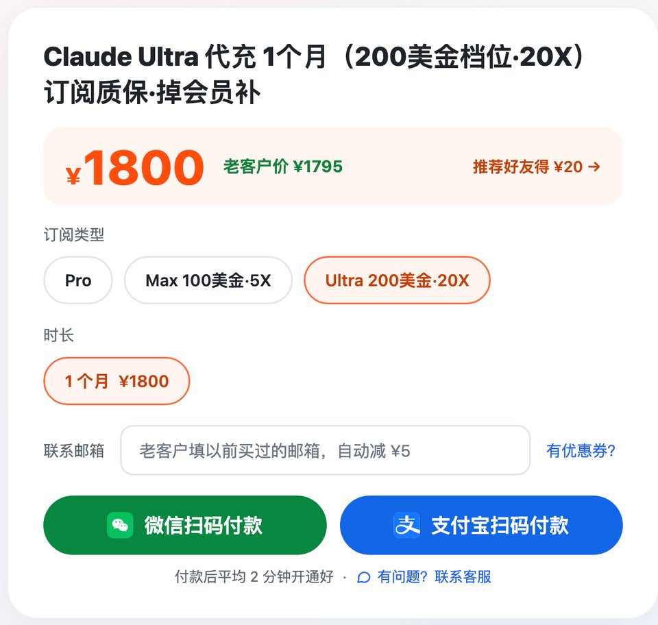
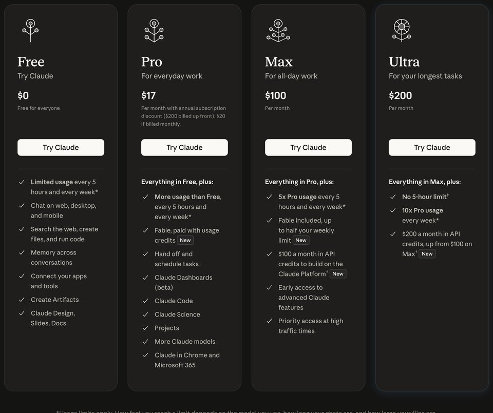
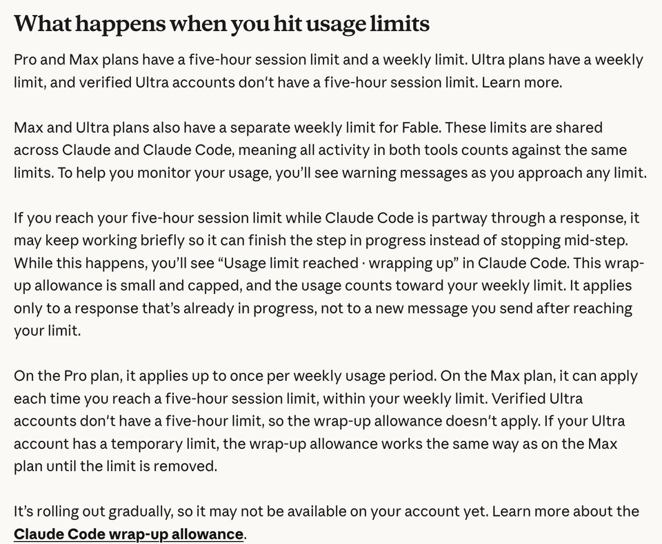
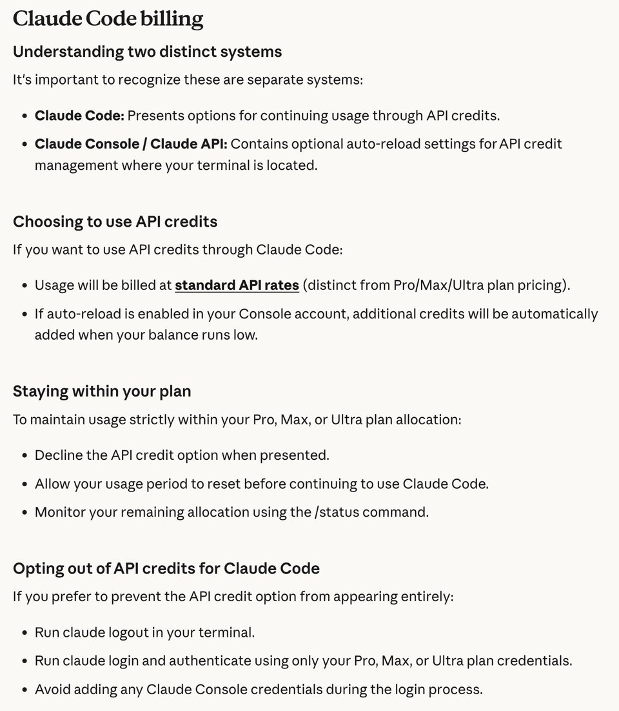

# Claude Code价格 2026：哪档能用、额度够不够、国内怎么开

> 2026-11-12 更新

**先说结论：** Claude Code价格没有单独一栏，它跟着 Claude 会员走，最低一档 claude code pro 就能用，官方每月 20 美元。国内没外币卡的，可以在瑶瑶ai训练师的商城开 [Claude Code订阅（Pro 档）¥159 一个月](https://kw.yaoyao.chat/item/12?utm_source=github&utm_medium=readme&utm_campaign=claudecode&utm_content=top)，开到你自己的号上，付完款只填组织 ID，平均 2 分钟到账，没开成就重新开或者退钱。下单填券码 **888888** 再减 ¥3。

- **三档都带**：官方 Pro 20 美元、Max 100 美元、Ultra 200 美元，Claude Code 都包含；免费版没有。店里一个月分别 ¥159、¥900、¥1,800。
- **额度跟聊天共用**：终端、编辑器插件、网页聊天吃的是同一份额度，5 小时一道闸、每周一道闸。
- **谁不用买**：只在 CI 或脚本里偶尔调几次模型的，直接用 API 按量付更合适；已经在官网订着会员的，Claude Code 本来就能用，不用另买。
- **ChatGPT 的 Codex 也想试**：瑶瑶店里最畅销的 [ChatGPT Plus ¥129/月](https://kw.yaoyao.chat/item/5?utm_source=github&utm_medium=readme&utm_campaign=claudecode&utm_content=plus-top) 自带 Codex，同样开在原号上。

*截图说明：瑶瑶商城选中 Ultra 200美金·20X 时的付款区，20X 沿用改名前的旧称。来源 kw.yaoyao.chat/item/12?d=max20x · 2026-11-10 截图*

## Claude Code价格到底怎么算

官方定价页常见问题里有一条专门回答"Claude Code 包含在套餐里吗"：所有付费套餐都包含，跟套餐其他部分共用同一份用量上限。所以说"Claude Code 多少钱"，其实是在问两件事：

1. **用订阅登录**：钱就是会员月费，Pro 20 美元（按年一次 200 美元，折合每月 17）、Max 100 美元、Ultra 200 美元，标价都不含税，Max 和 Ultra 只能按月。额度用完要么等、要么升档、要么另开 usage credits。
2. **用 API Key 或 Console 账号登录**：按 token 计费，用多少扣多少，没有 5 小时闸，也没有封顶。

*截图说明：Anthropic 官方定价页，Pro 那张卡片的功能列表里就有 Claude Code，往右两档在 Pro 基础上加量。来源 claude.com/pricing · 2026-11-10 截图*

绝大多数个人开发者走第一种。下面把三档放到"写代码"这个场景里看。

## 三档在 Claude Code 里差在哪

只挑写代码时真有感觉的几项，出处是官方定价页、Max 和 Ultra 两篇帮助文章、Claude Code 订阅说明，均于 11 月 10 日读过：

| 写代码时关心的 | Pro | Max | Ultra |
|---|---|---|---|
| 5 小时闸 | 有，基准 1 倍 | 有，Pro 的 5 倍 | 认证账号没有；未认证前有临时限制 |
| 每周上限 | 基准 1 倍 | Pro 的 5 倍 | Pro 的 10 倍 |
| Fable 模型 | 每次走 usage credits 另付 | 套餐内，最多占周额度一半 | 同 Max |
| 撞 5 小时闸时的收尾额度 | 每个周期最多一次 | 每次撞线都可能有 | 认证后用不上（没有 5 小时闸） |
| 每月附送 API 额度 | 无 | 100 美元，终端写代码花不了 | 200 美元，一样花不了 |

"收尾额度"是官方正在逐步放开的一项：Claude Code 正写到一半撞上 5 小时闸，会显示 `Usage limit reached · wrapping up`，让它把手头这一步做完再停，用掉的算进周额度。官方写明要 Claude Code 2.1.277 以上、用 Claude 账号登录，账号和组织还得满足一个不公开的最短存在时间，而且在逐步放开。用 API Key 登录的不适用。

最后一行很多人会误会：Max、Ultra 每月送的那笔 API 钱，官方说明它管不到终端里的 Claude Code 和各个 App，抵超额费用也不行，唯一的去处是自己写程序调用接口。

*截图说明：官方帮助文章里"撞到用量上限会怎样"那一节，两道上限、共用额度、收尾额度都在这几段。来源 support.claude.com · 2026-11-10 截图*

## claude code pro 够不够用

先说一句实话：官方不给 Claude Code 的条数，也不给"能写多少行"。够不够，取决于项目多大、对话拖多长、选哪个模型。下面是按官方说法推出的判断，不是保证：

- **够用的写法**：一天改几个小 bug、写几个脚本、让它解释陌生代码。做完一件事就 `/clear`，上下文不拖泥带水。
- **容易紧的写法**：让它在大仓库里到处读文件、一个对话从早聊到晚、默认就开最强的模型。官方 Claude Code 用量指南里写得很直白，Opus 每一轮的消耗是 Sonnet 的好几倍，日常编码用 Sonnet 足够，真卡住了再切 Opus。
- **该升 Max 的信号**：一周里好几天被 5 小时闸打断，换了省额度的写法也没改善。
- **该看 Ultra 的信号**：经常跑长任务、最怕中途被 5 小时闸掐断；但它的 10 倍只算每周，周额度一样会见底。

几条官方给的省额度习惯，挑最管用的：换任务前 `/clear`；任务做到一半对话太长，用 `/compact` 压成摘要接着干；贴代码不如给文件路径，让它自己挑着读；`CLAUDE.md` 控制在两百行左右；动两三个文件以上的改动，先让它列计划再动手。

Pro 不够时，[Claude Max 每月 ¥900](https://kw.yaoyao.chat/item/12?d=max5x&utm_source=github&utm_medium=readme&utm_campaign=claudecode&utm_content=mid) 和 [Claude Ultra 每月 ¥1,800](https://kw.yaoyao.chat/item/12?d=max20x&utm_source=github&utm_medium=readme&utm_campaign=claudecode&utm_content=mid2) 都在同一个下单页。要提前知道：号上正挂着 Pro 的，店里不能在上面补差价或覆盖，得等它到期回免费版，或者换一个非会员号来开。

## 订阅和 API 计费怎么选

这是写 Claude Code 的人最常算不清的一笔账。先看官方给的几个数字：

- **API 单价**（定价页 API 一栏，美元 / 每百万 token）：Sonnet 5.5 输入 2、输出 10；Opus 5.5 输入 4、输出 20；Haiku 5.5 输入 0.10、输出 0.50（提示超过 10 万 token 后另算）；Fable 5.1 输入 10、输出 50。批处理另省一半。
- **Claude Code 成本文档**：官方说 Claude Code 按 API token 计费时，在企业部署里平均每位开发者每个活跃日约 13 美元，每月约 150～250 美元，九成用户每个活跃日低于 30 美元。这是企业团队的平均数，个人差别很大。

拿这组数对比：Pro 一个月 20 美元，大约是企业平均下一两个活跃日的 API 花费；Max 100 美元，也不到企业平均的一个月。所以天天开着 Claude Code 干活的个人，订阅几乎总是更划算。反过来：

| 你的情况 | 更合适的计费 | 原因 |
|---|---|---|
| 每天手动跟 Claude Code 对话改项目 | 订阅 | 月费固定，到线等恢复 |
| CI、定时脚本、批量自动跑 | API Key | 订阅额度是给人手动用的；API 没有 5 小时闸 |
| 公司要统一记账、按人看花费 | API 或团队版 | Console 能按账号看用量 |
| 偶尔一周冲刺、订阅不够 | 订阅 + 临时 API | 官方建议冲刺时换 Console 买 API credits |
| 只想偶尔超一点 | 订阅 + usage credits | 超出部分按 API 标准价算，记得设每月上限 |

顺带一提，usage credits 买了就不退，取消订阅、删号也一样；2026 年 12 月 7 日起新买的，12 个月后过期，余额别一次囤太多。

两条防扣钱的细节，来自官方 Claude Code 订阅说明：

1. **环境变量里的 Key 会抢先。** 只要 `ANTHROPIC_API_KEY` 这个变量有值，Claude Code 优先用它认证，扣的是 API 钱，会员额度一点没动。不用就把它删掉，再 `/login` 换回 Claude 账号。
2. **想彻底不弹"改用 API 额度"。** 官方给的办法是先 `claude logout`，再 `claude login` 只用会员账号登录，登录过程里别加任何 Console 凭据；平时撞线时弹出用 API 额度的选项，点拒绝就不会扣。Console 那边的自动充值（auto-reload）也去账单设置里看一眼。

用 API Key 跑的，在 Claude Code 里 `/cost` 能看当前会话花了多少；用订阅的，`/usage` 显示的是套餐进度条，那块会话花费数字只是参考，不是账单。

订阅和 API 怎么取舍，ChatGPT 那边是同一个道理，可以对照着看 [订阅和 API 哪个划算](https://kw.yaoyao.chat/guide/dingyue-vs-api.html?utm_source=github&utm_medium=readme&utm_campaign=claudecode&utm_content=guide)；Claude Code 收费的店内整理版在 [Claude Code 怎么收费](https://kw.yaoyao.chat/guide/claude-code.html?utm_source=github&utm_medium=readme&utm_campaign=claudecode&utm_content=guide)。

*截图说明：同一篇官方帮助文章的计费一节，写明订阅和 API 分属两套系统，以及怎样只用套餐额度。来源 support.claude.com · 2026-11-10 截图*

## 国内怎么开：claude code充值 的几条路

很多人搜"claude code充值"，其实要的是会员，不是 API 余额。先把方向弄对：

- **想在终端里用订阅额度**：开 Pro、Max 或 Ultra 会员，用同一个 Claude 账号登录 Claude Code。在 Console 里充的钱，不会让你的账号变成会员。
- **想按 token 付费**：去 Claude Console 充 API 余额，拿 Key 登录。这才是字面意义上的给 Claude Code 充值。

开会员这条路，国内常见的有三种：

1. **官网绑卡**：claude.ai 结账页写的付款方式是信用卡，国内发的卡常被拒。
2. **App 内购**：要支持地区的 Apple ID 或 Google 账号，手机里的价格以应用商店为准。
3. **代付到自己号**：卖家替你交会员费，开在你注册的号上。瑶瑶店里就是这种，付款后在订单页填组织 ID，平均 2 分钟开好，流程见 [国内用支付宝开 Claude Pro 的流程](https://kw.yaoyao.chat/guide/claude-pro-daichong.html?utm_source=github&utm_medium=readme&utm_campaign=claudecode&utm_content=guide)。

不管哪条路，地区规定都绕不开：Anthropic 支持地区页开头就写明，官方的应用（Claude Code 也点名在内）只对名单上的国家和地区开放，其余一律不支持，人在名单外使用也算。大陆、港澳都不在名单上。在台湾或海外、没有大陆支付宝的，付款办法另见 [海外用户怎么付款](https://kw.yaoyao.chat/guide/haiwai-fukuan.html?utm_source=github&utm_medium=readme&utm_campaign=claudecode&utm_content=guide)。几种路线的利弊，ChatGPT 版本整理过一份 [代充、苹果内购、虚拟卡哪个好](https://kw.yaoyao.chat/guide/daichong-vs-neigou.html?utm_source=github&utm_medium=readme&utm_campaign=claudecode&utm_content=guide)，思路相通。

店里的售后口径照实说：开通失败重开或 24 小时内全额退回；本期掉会员补一个月到原号；封号不保、不退，Claude 封号瑶瑶协助走官方申诉，结果看官方。

开好以后怎么确认会员真的到了、Claude Code 登的是不是会员账号，同一作者在 [Claude代充 / Claude充值 开通后怎么核对](https://github.com/haiwaihuyonghui-rgb/claude-chongzhi) 里列了检查清单。

## 和 Codex 怎么比

同样是"在终端里让 AI 改项目"，ChatGPT 那边是 Codex，跟着 ChatGPT 会员走。两家的计费思路很像：会员里自带一份额度，用完可以另买 credits。Codex 各档能用多少、Plus 够不够，见 [Codex 多少钱](https://kw.yaoyao.chat/guide/codex-price.html?utm_source=github&utm_medium=readme&utm_campaign=claudecode&utm_content=guide) 和 GitHub 上的 [Codex订阅价格](https://github.com/yaoyao-chat/codex)；国内怎么用，见 [Codex 国内怎么用](https://kw.yaoyao.chat/guide/codex.html?utm_source=github&utm_medium=readme&utm_campaign=claudecode&utm_content=guide)。两个都想用的，ChatGPT 那边可以看 [Plus 会员里的 Codex 能干什么](https://github.com/yaoyao-chat/plus)。没有外币卡的，ChatGPT 那边的办法也整理过：[没有外币信用卡怎么开 ChatGPT Plus](https://kw.yaoyao.chat/guide/meiyou-waibika.html?utm_source=github&utm_medium=readme&utm_campaign=claudecode&utm_content=guide)。

## 常见问题

**问：Claude Code价格是多少，要单独买吗？**
不用单独买。开 Pro（官方 20 美元一个月）就能用，Max、Ultra 额度更多。用 API Key 登录才按 token 计费。

**问：claude code pro 和 Max 写代码差多少？**
Max 的 5 小时闸和周上限都是 Pro 的 5 倍，另外套餐里含 Fable；Pro 用 Fable 要另付。

**问：claude code订阅能用支付宝吗？**
官网不行，[官方定价页](https://claude.com/pricing) 写的付款方式是信用卡。要用支付宝或微信，只能找代付开到自己号上。

**问：在终端用 Claude Code，额度跟网页聊天是一份吗？**
是一份。终端、编辑器插件、桌面版、网页、手机算同一份。

**问：Max 送的 100 美元 API 额度能给 Claude Code 用吗？**
用不上。官方把它限定在开发者平台的接口调用，终端里写代码消耗的是会员额度。

**问：终端里提示余额不足、让我去 Console 充值，是会员没开好吗？**
多半是 `ANTHROPIC_API_KEY` 变量还在，或者眼下登的是 Console 账号。用 `/status` 看身份，再 `/login` 换回会员账号；报错原文的解释见 [Claude Code 报错说明](https://code.claude.com/docs/en/errors)。

**问：Pro 在 Claude Code 里能用 Fable 吗？**
能用，但不算进 Pro 的套餐额度，每次都走 usage credits、按 API 标准价另付；Max 和 Ultra 的套餐里就含，最多占周额度一半，而且比别的模型扣得快。

**问：在瑶瑶店里开的会员能直接用 Claude Code 吗？**
能，开在你自己的号上，Claude Code 用同一个账号登录就行。

准备好了，三档都在 [Claude Code价格三档同页：Pro ¥159 / Max ¥900 / Ultra ¥1,800](https://kw.yaoyao.chat/item/12?utm_source=github&utm_medium=readme&utm_campaign=claudecode&utm_content=end)，付款前填 **888888** 再省 ¥3（全店通用，推荐码、老客户减 ¥5 和它不叠加）。

## 相关教程

- [ChatGPT Plus购买指南（自带 Codex）](https://github.com/yaoyao-chat/plus)
- [Claude代充 / Claude充值：组织 ID 与开通核对](https://github.com/haiwaihuyonghui-rgb/claude-chongzhi)
- [Codex订阅价格：Plus、Pro 各能用多少](https://github.com/yaoyao-chat/codex)

## 核对与来源

以下官方页面 2026-11-10 当天打开逐条对过，价格和规则以官方当天显示为准：

- [官方定价页](https://claude.com/pricing)：Pro 按月 20 美元或按年 200 美元，Max 100 美元、Ultra 200 美元都只按月，标价不含税；所有付费套餐含 Claude Code、与其他用量共用；对比表 5 小时 1x / 5x / 无，每周 1x / 5x / 10x；Fable 各档用法；API 一栏单价、批处理省 50%；付款方式信用卡
- [帮助中心：用会员登录 Claude Code](https://support.claude.com/en/articles/11145838-use-claude-code-with-your-pro-max-or-ultra-plan)：同账号登录、`/login` 从 Console 切换、`ANTHROPIC_API_KEY` 优先、IDE 共用、各档撞线后的选择、收尾额度、Max/Ultra 的 API 额度不能用于 Claude Code、拒绝 API 选项和 logout/login 的办法、auto-reload 在 Console
- [帮助中心：收尾额度说明](https://support.claude.com/en/articles/17040437-claude-code-wrap-up-allowance)：2.1.277 以上、Pro 每周期一次、Max 每次撞线、API Key 不适用、逐步放开
- [帮助中心：Claude Code 的模型与用量](https://support.claude.com/en/articles/14552983-models-usage-and-limits-in-claude-code)：Opus 每轮消耗是 Sonnet 的好几倍、`/clear`、`/compact`、CLAUDE.md 约 200 行、先列计划
- [Claude Code 文档：成本与用量](https://code.claude.com/docs/en/costs)：按 API token 计费；企业部署平均每活跃日约 13 美元、每月 150～250 美元、九成低于 30 美元；`/usage` 对订阅用户显示套餐进度条
- [帮助中心：管理 usage credits](https://support.claude.com/en/articles/12429409-manage-usage-credits-for-paid-claude-plans)：超出按 API 标准价、可设每月上限
- [帮助中心：Ultra 套餐说明](https://support.claude.com/en/articles/17728952-what-is-the-ultra-plan)：周额度是 Pro 的 10 倍，认证后取消 5 小时闸，认证前先有临时限制
- [支持地区名单](https://anthropic.com/supported-countries)：官方应用含 Claude Code 只对名单内开放，大陆、港澳不在名单
- [Claude Code 文档：报错对照](https://code.claude.com/docs/en/errors)：余额不足类报错的原因

店里的价格、到账时间、退款、补会员和封号口径，照商城事实卡写（11-10 凌晨导出）；挂着会员的号不能补差价或覆盖，属于店主 10-30 定的规矩；"够不够用"和订阅、API 怎么取舍，属于经验判断，不是官方数据。

## 关于作者与声明

执笔的是瑶瑶ai训练师，她从 2023 年 10 月开始讲 AI，几个平台加总约 320 万粉丝；这篇是 kw.yaoyao.chat 店主亲自整理的，所有指向商城的链接都属于广告。代充不是官方渠道，店里和 Anthropic 没有从属关系，也没被授权。开 Claude 只需要组织 ID，账号密码和验证码不要交给任何人，包括自称瑶瑶客服的；正经客服只在企业微信 `kw.yaoyao.chat/wecom`，认准这一个。

原文地址：[github.com/yaoyao-chat/claudecode](https://github.com/yaoyao-chat/claudecode)（CC BY-ND 4.0，转载请保留原文地址、不得改编）
